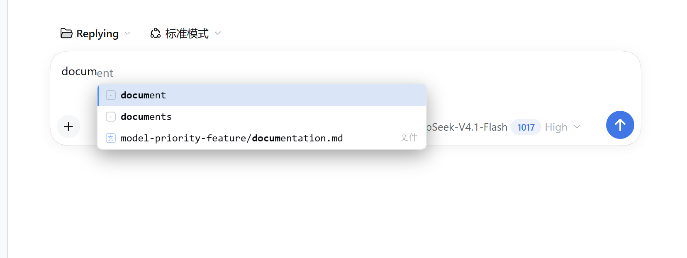
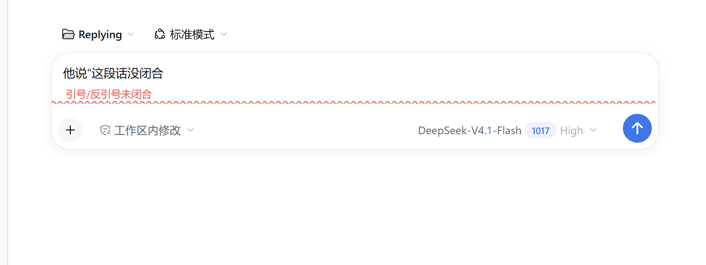
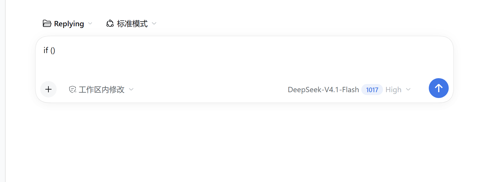

# dsh-composer-ease — a VS Code-feel composer for DeepSeek Harness

**[English](README.md) · [中文](README.zh.md)**

Gives the DeepSeek Harness (DSH) web composer the **VS Code** editing feel: brackets and quotes pair up as you type,
typing an opener over a selection wraps the selection, a closer over an existing closer is skipped, backspace removes an
empty pair — plus a completion popup fed by words in your draft, per-language keywords and tags, workspace files,
model ids from your settings and code snippets.

A standard DSH bundle plugin: one command to install, **zero runtime dependencies**, **writes no files**,
**changes no host source**, **needs no token**. The browser half is plain DOM (no React, no editor library);
the server half exposes read-only routes only.


## Four shots (taken on the real app, not mockups)

| Completion + inline ghost text | `/` menu |
|---|---|
|  |  |
| Type `docum`: candidates are labelled file / keyword / English word; the grey `ent` is the **inline preview** and follows `↑` `↓` | `/` holds **three** toggles: quote mode / candidate kinds (four presets) / strict pairing — settings never take candidate slots |

| Unclosed quote squiggle | Bracket pairing |
|---|---|
|  |  |
| A red **wave under the text** (VS Code squiggle) plus a hint line; typing is never blocked | `(` becomes `()` with the caret in the middle; select a passage and type an opener to wrap it |


*Recorded on the real app (Playwright frames + gifenc); the pipeline lives in `docs/如何做 README 图.md`.*

## Quick start

```bash
# DSH Web (recommended)
dsh plugin --profile web add https://github.com/mengge237/dsh-composer-ease

# or a local checkout (when editing code)
dsh plugin --profile web add "<your plugin directory>"
```

Uninstall: `dsh plugin --profile web remove dsh-composer-ease` (no data files are left behind).
On the desktop app use its own plugin manager — `dsh plugin --profile desktop` is rejected by the CLI.

## What it does

| You do | It does |
|---|---|
| Pairing and wrapping | `(` `[` `{` `"` `` ` `` and the full-width family pair up; **select a passage and type an opener to wrap it**, caret back inside |
| Type-over / delete empty pair | A closer already to the right is skipped; backspace between `()` removes both sides |
| Completion popup | Opens after two characters: draft words, language keywords and tags, **workspace files**, model ids from settings, snippets |
| Inline preview | The top candidate's remainder sits after the caret in grey, **following `↑` `↓`**; `Tab` accepts, Enter still sends |
| `/` menu | Three toggles: quote mode, candidate kinds (four presets), strict pairing. The rows follow the query (`/comp` pushes them aside) and a **mistyped command still completes**: `/compot` → `/compact` |
| Unclosed quote | A red wave **under the text** (per line, at the text box bottom) plus a hint line; typing is not blocked |

## How file candidates are ranked (change this and the table together)

| Weight | Which files |
|---|---|
| 1000 | top-level `README` / `CHANGELOG` / `AGENTS` / `CLAUDE` / `CONTRIBUTING` / `package` (`.md`) |
| 700 | the same names, not at top level |
| 500 | other top-level `.md` |
| 400 | `docs/**/*.md` |
| 300 | other `.md` |
| 0 | everything else (newest first) |

Implemented in `contextScore()` and `collectFiles()` in `lib/index.js`; the skip list is `SKIP_DIRS` in the same file.

## Where to install

| Target | How | Note |
|---|---|---|
| **DSH Web (`dsh web`)** | `dsh plugin --profile web add https://github.com/mengge237/dsh-composer-ease` | Recommended; a local directory works too |
| **Desktop app (Electron)** | The desktop app's own plugin manager | Do not use `dsh plugin --profile desktop` (owned by Electron, the CLI refuses) |
| **Development** | checkout + a `file:` install | The browser half is **read from disk on every request** (refresh to apply); the server half (`lib/index.js`, `lib/words.js`) needs a `dsh web` restart |

## Features

### Editing feel (aligned with VS Code)

- **Auto pairing**: `(` `[` `{` `"` `'` and backtick insert as a pair with the caret in the middle; **full-width forms too** (`（` `【` `「` `《` `“` `‘`), completed through the `input` event because IME compositions do not always produce a keydown; no pairing when the character before the caret is an identifier or path character (keeps `call(` and paths intact)
- **Surround selection**: select a passage and type an opener → `(selection)` with the **selection restored to the inner text**; ASCII goes through keydown, **full-width and IME through `beforeinput`**; `Shift` combinations work the same
- **Inline ghost text**: the remainder of the top candidate after the caret, in grey (VS Code's inline suggestion feel); `Tab` takes it, `Esc` hides it
- **Type-over closers**, **delete empty pair**, **language hint** from a fence (```` ```js ```` / ```` ```python ````)

### Popup placement and behaviour

- **Anchored to the caret**, never to the composer's left edge; prefers the space below, flips 6px above when there is none
- **Fixed width, capped height with scrolling**; **no repaint when the list is unchanged** (no flicker, never two popups)
- **Row layout follows VS Code**: type icon on the left, label in the middle with matched characters in bold, a muted type word on the right

### Candidates (four kinds)

- **Draft words**: identifiers already in the draft, by frequency, **computed locally** (word based suggestions)
- **Ranking = VS Code's fuzzy score**: `lib/fuzzy.js` is copied verbatim from microsoft/vscode (MIT, see THIRD-PARTY.md); the match positions it returns bold the characters in the list
- **Language tables**: 112 HTML tags, 47 JS keywords, 129 Python, 56 Java, 600 CSS properties, 27 HTML global attributes
- **Chinese words too**: runs of CJK characters are split into 2/3-grams, so typing 「文」 can offer 「文档」
- **Context candidates**: identifiers (4+ chars) from the visible conversation text, labelled “context” — a name you just discussed does not need retyping (read-only, 2s cache, host DOM untouched)
- **Language inference** from context, then **habit** (a fence or an accepted table candidate counts as a vote, stored in local `localStorage`)
- **Workspace files** (depth ≤3, `node_modules` skipped, matched on path-segment prefixes) and **model ids + snippets**

### Trigger and accept

- Opens after **two identifier characters**; `Ctrl+Space` opens it manually; `/` and `@` at line start or after whitespace open the host menus
- **Comment lines do not complete**: when the caret's line starts with `//`, `#`, `<!--` or `--` (indentation allowed) nothing pops up; text inside quotes still completes
- **`Tab` accepts** (or click a row); `↑` `↓` select; `Esc` closes; **`←` `→` / `Home` / `End` dismiss the popup** and only move the caret — keep typing and it comes back
- **Enter is never swallowed**: Enter sends in a chat box (it used to accept, which inserted candidates over and over)

### Performance

- The workspace file index and model ids carry **20-second TTL caches**: one full pass ≈23ms, cache hits 0–1ms
- One loopback request per keystroke; stale responses are dropped by sequence number

## Keymap (vs VS Code)

| Action | Key / trigger | Behaviour |
|---|---|---|
| Auto pair | `(` `[` `{` `"` `'` backtick; full-width `（` `【` `「` `《` `“` `‘` | No pairing after a path/identifier character; with text to the **right** only the opener is inserted; skipped when the matching closer is already there |
| Surround | type any opener over a selection | `selection` → `(selection)`, selection stays on the inner text |
| Type-over | type a closer already to the right | no duplicate, caret moves past it |
| Delete empty pair | backspace between `()` | removes both sides |
| Complete | two identifier characters / `Ctrl+Space` | popup: draft words first, then tables / files / models / snippets |
| Accept | **`Tab` only**, or click a row | Enter stays the send key; the popup does not reopen after accepting |
| Dismiss / select | `Esc` / `↑` `↓` | `Shift+Enter` still inserts a newline |
| Dismiss while moving | `←` `→` / `Home` / `End` | closes the popup, inserts nothing, then typing completes again |

## Candidate matching rules

- **File candidates must start a path segment**: `index` → `notes/index.diff` first; a match inside a segment needs 3+ characters
- **No pure-subsequence matching for paths**: paths are long, a subsequence hits almost everything
- Subsequences are kept for short candidates (tables / models / snippets) and only for queries of 3+ characters

## Known limits

**Quotes pair by default, like brackets.** `"` `'` `“` `‘` insert a pair with the caret in the middle; “red squiggle” is now an explicit toggle in the `/` menu (switch to it to insert a single character instead). Two guards stay: no pairing when the character to the right is text, and none after a path/identifier character. Typing the same quote inside an empty pair is **skipped** (three presses still give one pair) — the triple-backtick fence is unaffected because backticks are not in the quote family.

**The `<p><br>` in an empty composer is not leftover text.** Lexical always renders `<p dir="auto"><br data-lexical-managed-linebreak="true"></p>`; `innerText` reports it as `"\n"`. Test emptiness with `textContent`; deleting the paragraph gets rebuilt within ~100ms.

**Strict pairing** is still a toggle in the `/` menu: off (default) pairs quotes with the two guards above; on it also pairs when text is to the right.

- **Server-half edits need a `dsh web` restart** (ESM is not re-read); the browser half applies on refresh
- Word-table keys live on the server, so `inp` → `input` needs one restart after install or table edits
- Verified against **0.2.0-rc.2+** on the web and desktop profiles (re-run the self-check after a host upgrade)
- The legacy `textarea` composer has offline coverage only
- **The host composer's data model is not touched**: `Alt+↑/↓`, `Ctrl+D`, `Ctrl+/` are not implemented
- **Candidates containing spaces cannot be inserted** by the host editor: `execCommand('insertText')` silently drops text with spaces, and the `paste` channel lands asynchronously. The accept path therefore verifies the whole draft and rolls back that one edit, so the original text is never eaten and the popup stays open; single-word candidates are fine
- The squiggle is drawn at the **text line's** bottom (measured from text nodes per line), not at the composer's bottom border
- **Multi-line selections are not wrapped**: the host's paste channel drops the trailing closer and only repaints on the next editor update. Single-line selections wrap normally and undo in one step
- Completion only inserts text; it does not analyse which symbols are in scope

## Repository layout

| Path | Purpose |
|---|---|
| `lib/index.js` | Server half: read-only routes (`/dsh-composer-ease/words`, `/config.json`) and the loopback trust fence |
| `lib/client.js` | Browser half, generated from `lib/client/*.js` fragments |
| `lib/words.js` | Language tables (static arrays; provenance in the file header) |
| `lib/fuzzy.js` | VS Code's fuzzy scoring (verbatim, MIT) |
| `test/` | Five offline suites, the live matrix and the acceptance reports |
| `docs/` | README images and notes |
| `THIRD-PARTY.md` | Borrowed data with full license texts |
| `cordis.patch.yml` | DSH bundle declaration |

## One copy on this machine: the host directory is a junction to this repo

```bash
node tools/link-host.mjs          # report the current relation (changes nothing)
node tools/link-host.mjs --apply  # merge into one when needed (old dir kept as .hostbak)
```

After editing: `npm run build`; the browser half applies on refresh, the server half still needs a `dsh web` restart.

## Maintainer environment variables

```bash
npm run check:host                    # verify the junction / copy relation
npm run link:host -- --apply          # rebuild it after moving machines
DEMO_DEPS="<node_modules with gifenc/pngjs>" npm run record:demo -- "<url>" --out docs/demo.gif
```

Neither takes a default path: a hard-coded local path is unportable and leaks machine details into a public repo.

## Development and tests

```bash
npm test        # five offline suites, 181 items, zero network
```

- `test/selftest.mjs`: ranking, model id parsing, file collection caps, `workspace.json` v2, table hits
- `test/server-routes.mjs`: route shape, the **loopback trust fence** (non-loopback Host / cross-site Origin → 403), method gate, `config.json`
- `test/client-smoke.mjs`: bundle shape, export surface, keymap decisions, draft words and fence detection
- `test/client-behavior.mjs`: **fake DOM driving the real listeners** — pairing, surround, type-over, empty-pair delete, `Ctrl+Space`, Tab accept, Enter pass-through, comment lines, arrow dismissal
- `test/compliance.mjs`: **licensing and rule compliance** — own MIT notice, every borrowed item in THIRD-PARTY.md with repo + license + pinned commit, upstream notices preserved, no runtime dependencies, no secrets, version matches the changelog
- Live matrix: `node test/real/matrix.mjs "http://127.0.0.1:3081/?token=…" 3` — 32 cases (completion 6 / keys 6 / pairing 7 / `/` menu 3 / edge cases 8 / stability 2) × N rounds, printing per-round pass counts and readings; it needs a running demo host (`dsh --profile demo --port 3081 --no-open`), so it is not part of `npm test`
- Live acceptance scripts: `test/real/real5.mjs`, `test/real/real-regress.mjs`; reports in `test/REPORT-2026-10-16.md` and `test/REPORT-2026-10-20.md`

The host composer is **Lexical** and follows three rules: it ignores `sel.modify(...)` (use flattened offsets plus an explicit Range), it ignores `beforeinput`'s `preventDefault` (let it insert, then repair), and selection writes need cross-frame verification because `input` is not guaranteed to fire

## FAQ

- **Typing `inp` does not offer `input`?** Word tables live on the server half: restart `dsh web` once after installing or editing them
- **Why does Enter not accept?** Enter is the send key; use `Tab`
- **Why did a quote only insert one character?** The “red squiggle” toggle in the `/` menu is on; switch back to auto pairing
- **Does it modify my files?** No. It reads the workspace file list and the settings source of truth and writes nothing
- **Desktop app?** A separate profile; install through its own plugin manager

## Version and changelog

- Version: `package.json` is the source of truth
- What changed in each release and which commit: [CHANGELOG.md](CHANGELOG.md)

## Sources and licenses

- **Interaction design** follows Visual Studio Code (MIT, microsoft/vscode): word-boundary suppression, surround, type-over closers, empty-pair deletion and the word based suggestion ranking — no source copied except `lib/fuzzy.js` (verbatim, see THIRD-PARTY.md)
- **Word-table data** comes from monaco-editor, codemirror/lang-html, codemirror/lang-css and MDN browser-compat-data; [THIRD-PARTY.md](THIRD-PARTY.md) records repo, commit, files and the **full license text**. Extraction is static; nothing depends on them at runtime
- This plugin: MIT (see [LICENSE](LICENSE))

---

[中文版 README](README.zh.md)
