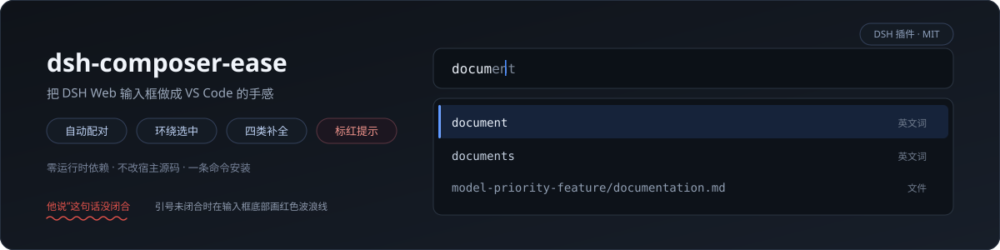

# 更便捷的输入框（dsh-composer-ease · DSH 输入框增强）

**[中文](README.md) · [English](README.en.md)**




*动图录的是前两个镜头（真机录制，纯净 profile：只有官方插件 + 本插件）。三个镜头都给出「凭什么这么补」的依据行：*

- **镜头 ①：围栏决定词表。** 新会话里写 ` ```py ` 再打 `def` —— 弹层顶上标「本文围栏 · py」，给的是 Python 词表。
- **镜头 ②：对话决定词表。** 对话里已经有 Java 代码时打 `pub` —— 顶上标「据对话推断 · java」，首条直接是 `public`。
- **镜头 ③：文件上下文按「常用」排，不按字母排。**（本轮新增，动图待重录）打 `proj` → 当前工作区的
  `PROJECT_MEMORY.md` 排在第一条；打 `rea` → 别处仓库副本（`ref_repo/`、`third_party/`、`external/`）里的
  README 不会顶上来，`临时目录` 这类中间态目录**整目录不进候选**。
  真机读数（2026-10-21，demo 宿主 3081）：`proj` → 候选 2 条，第 1 条 `PROJECT_MEMORY.md`；
  `rea` → 8 条全是真项目里的 README / 分析笔记，含中间态目录的候选 **0 条**。

把 DeepSeek Harness（DSH）Web 输入框的手感对齐 **VS Code**：括号引号自动配对、选中一段再打括号就环绕起来、
光标右边已是闭符时再打它直接跳过、退格删掉一对空括号；再给一个补全弹层——**草稿里出现过的词、各语言关键字与标签、
工作区文件路径、settings 里配的模型名**，打满两个字母自己弹。

标准 DSH bundle 插件：一条命令安装、**不 require 任何第三方包**、**不写任何文件**、**不改宿主一行源码**，也不需要任何令牌。
浏览器半边是纯 DOM（不依赖 react、不引编辑器库），服务端半边只有两个只读路由。

## 概览

一句话：**让 DSH 的输入框在「写代码」和「引用文件」这两件事上少按几次键。**

| 你会用到的 | 它替你做什么 |
|---|---|
| 配对与环绕 | `(` `[` `{` `"` `` ` `` 与全角家族自动成对；**选中一段再打括号，直接框住**，光标落回内容里 |
| 跳闭合 / 删空对 | 光标右边就是闭符时再打它 → 跳过；退格里是空对 → 一次删两侧 |
| 补全弹层 | 打满两个字符自动弹：**草稿里出现过的词**、语言关键字与标签、**工作区文件路径**、settings 里的模型名 |
| 行内灰字 | 首位候选以灰字接在当前 token 后面，`Tab` 接受、回车保持发送 |
| **文件上下文** | 候选里的文件按「常用作上下文」排：`README`/`CHANGELOG`/`AGENTS` 在最前，`docs/**` 次之，中间态目录（`临时目录`/`临时目录`/构建产物）**根本不进候选** |

## 文件上下文候选怎么排（改了这一条请同时改这里）

| 权重 | 什么文件 |
|---|---|
| 1000 | 顶层 `README` / `CHANGELOG` / `AGENTS` / `CLAUDE` / `CONTRIBUTING` / `package`（`.md`） |
| 700 | 同样的名字，但不在顶层 |
| 500 | 顶层其它 `.md` |
| 400 | `docs/**/*.md` |
| 300 | 其它 `.md` |
| 0 | 其余文件（按修改时间新→旧） |

实现位于 `lib/index.js` 的 `contextScore()` 与 `collectFiles()`；目录跳过表是同文件的 `SKIP_DIRS`。

## 装在哪、怎么装

| 你要装在哪 | 装法 | 注意 |
|---|---|---|
| **DSH Web（`dsh web`）** | `dsh plugin --profile web add https://github.com/mengge237/dsh-composer-ease` | 推荐。也可以装本机源码目录：`dsh plugin --profile web add "<本地路径>"` |
| **官方桌面端（Electron）** | 用**桌面端自己的插件管理器**装 | 别用 `dsh plugin --profile desktop`（那条路被 Electron 独占，CLI 会拒绝）；桌面端会话里让 DSH 自己装 |
| **开发（改代码）** | 源码目录 + `file:` 装法 | 客户端半边**每次请求现读磁盘**，改完刷新页面即生效；**服务端半边（`lib/index.js`、`lib/words.js`）改完要重启 `dsh web`** |

卸载：`dsh plugin --profile web remove dsh-composer-ease`（不留任何数据文件，没有要清理的东西）。

## 特性

### 编辑手感（对齐 VS Code）

- **自动配对**：`(` `[` `{` `"` `'` 反引号成对插入，光标落在中间；**全角也一样**（`（` `【` `「` `《` `“` `‘`），中文输入法下走 input 事件补配对（IME 合成的字符不一定带对应 keydown）；光标前是标识符或路径字符时**不**配对（保护 `call(` 与 `E:/path` 这类写法）
- **环绕选区**：选中一段再打开括号 → `(选中内容)`，并且**选区还原到内层内容**上，接着打字就是改内容；
  半角走 keydown、**全角/中文输入法走 `beforeinput`**（IME 合成的字符没有可用的 keydown，只有 beforeinput 能在 DOM 变更前拿到要插的字符）；`Shift` 组合键打出的 `{` `"` 同样有效
- **行内灰字提示**：首位候选比已打的前缀多出来的那截，用灰字贴在光标后面（VSCode inline suggestion 手感），`Tab` 收下、`Esc` 收起
- **跳过闭符**：光标右边已经是该配对的闭符时，再打它只移动光标，不重复插
- **删空对**：光标夹在 `()` 中间按退格，一次删掉两侧
- **语言提示**：草稿里写了代码围栏（```` ```js ```` / ```` ```python ````）就按该语言上词表

### 补全弹层的位置与手感（对齐 VSCode）

- **锚在光标上**，不是输入框左边缘：一行长文时不会把弹层甩到半屏外
- **优先落在光标下方**；下方放不下（输入框在窗口底部，通常如此）才翻到**光标上方 6px**，永远不盖住你正在写的那一行
- **宽度固定一档、高度封顶可滚**：宽度不随候选长短抖动，打字快时不会一跳一跳
- **行内排版照 VS Code**：左边类型图标、中间标签（命中字符加粗）、**右边**一个淡类型词——类型信息一律在右侧，
  不会跑到候选名前面去
- **候选列表没变就不重画**：连续按键时不会闪，也不会出现两个弹层

### 补全候选（四类）

- **本文词**：草稿里已经出现过的标识符，按出现次数排序，**本地即时算、不等网络**（VSCode 的 word based suggestions 口径）
- **排序口径 = VS Code 的模糊打分**：`lib/fuzzy.js` **逐字取自 microsoft/vscode**（MIT，见 THIRD-PARTY.md）——
  前缀、词边界、驼峰、连续命中都加分，间隔与分散扣分；命中位置由它给出，列表里**命中的字符加粗**（就是 VS Code 那个样子）
- **语言词表**：HTML 标签 112、JS 关键字 47、Python 129、Java 56、CSS 属性 600、HTML 全局属性 27（数据来源见「来源与许可」）
- **中文词也算候选**：草稿与上下文里的**汉字词**（按二元/三元组拆，中文没空格分词）同样按前缀提示——
  写过「关于文档的说明」，后面打「文」就提示「文档」，跟写代码时提示变量一个手感
- **上下文候选**：页面上可见的对话文本里出现过的标识符（≥4 字符）也按前缀补出来，右侧类型标「上下文」——
  刚讨论过的函数名、文件名不用再手打一遍（只读页面文本，2 秒缓存，不动宿主 DOM）
- **语言推断**：没写围栏时先按上下文猜（`def`/`import`/`.py` → python，`<div>` → html，`const`/`await` → javascript），
  猜不出再退到习惯
- **语言习惯**：没写围栏时按**你实际在用的语言**上词表——草稿里写过 ```` ```js ```` 或接受过某套词表的候选都会记一笔（存本机 `localStorage`，不上传任何东西）
- **工作区文件**：深度 ≤3、跳过 `node_modules`，按**路径段前缀**匹配（见「候选匹配规则」）
- **模型名与片段**：从 settings 真源读出的模型 id，加上几个常用代码片段

### 触发与接受

- 打满 **2 个标识符字符自动弹**；`Ctrl+Space` 手动弹；行首或空白后打 `/`、`@` 也弹
- **`Tab` 接受**（或鼠标点某一行）；`↑↓` 选择；`Esc` 关闭
- **回车不吃弹层**：聊天框里回车就是发送。这条是 2026-10-16 真机事故换来的——原来回车也算接受，弹层开着时连按回车会把候选一遍遍插进正文

### 性能

- 工作区文件索引与模型 id 各带 **20 秒 TTL 缓存**：首次全盘走一遍约 23ms，之后命中 0~1ms
- 每个按键只发一次本地请求（loopback），后发先至的旧响应按序号丢弃

## 键位（对照 VS Code）

| 操作 | 键 / 触发 | 行为 |
|---|---|---|
| 自动配对 | `(` `[` `{` `"` `'` 反引号；全角 `（` `【` `「` `《` `“` `‘` | 光标前是路径/标识符字符时**不**配对；光标**右边紧跟文字**时只插这一个开符（在一段文字前打前引号就只出一个引号）；右边已是同一个闭符时跳过 |
| 环绕选区 | 选中后打任意开括号 | `选区` → `(选区)`，选区保持在内层 |
| 跳过闭合 | 光标右已是应得的闭符时再打它 | 不重复插，移过去 |
| 删空对 | 光标夹在 `()` 中间按退格 | 一次删两侧 |
| 补全 | 打满 2 个标识符字符 / `Ctrl+Space` | 弹层：本文词优先，其后语言词表 / 文件 / 模型 / 片段 |
| 接受 | **只有 `Tab`** 或点击某一行 | 回车保持发送；接受后弹层不会自己复开 |
| 关闭与选择 | `Esc` / `↑` `↓` | `Shift+Enter` 仍是换行 |

## 候选匹配规则

- **文件候选只认「某个路径段以查询开头」**：`attrib` → `临时目录/attrib-index.diff` 排第一；段内中段匹配要求查询 ≥3 个字符
- **不做松散模糊（纯子序列）**：路径本来就长，子序列几乎必中，等于「打一个字给你一堆别的文件」，会逼着人逐个核对
- 子序列只留给词表 / 模型 / 片段这类短候选，且查询至少 3 个字符

## 已知边界

**引号与括号一样自动配对（2026-10-22 恢复）。** `"` `'` `“` `‘` 打一个得一对、光标落在中间；
两条护栏照旧：**右边紧跟文字时不补**（在一段已有文字前打前引号只会出一个），**光标前是路径/标识符字符时不补**。
空对里再打同一个引号会**跳过**（连打三下仍是一对），所以顺带丢掉了"连打三个引号"的用法 —— 需要三连的是 ``` 围栏，那条走反引号，不受影响。

历史：2026-10-21 曾把引号改成"只插一个"，原因是配对后靠 DOM Range 复位光标，Lexical 的模型选区不认它，
快速连打会多冒一个；现在走 `insertAtomic` + `placeCaretVerified` 那条带**文本护栏 + 跨帧校验**的链，
并加了"空对里再打同一个一律跳过"的兜底，真机（demo 3081）七景读数全对：空框一对 caret=1、连打两下仍是 `""`、打引号后立刻打字落在两符之间。

**空输入框里那个 `<p><br>` 不是残留字符。** 编辑器（Lexical）渲染空文档时固定是 `<p dir="auto"><br data-lexical-managed-linebreak="true"></p>`，
而 `innerText` 会把它报成 `"\n"`。判断"输入框是否为空"请看 `textContent`（为空即空），别用 `innerText`；
手动删掉那个 `<p>` 也会在 100 ms 内被编辑器重建（实测三次取样都被重建）。

**「严格配对」这条开关还在**（`/` 菜单里我们那组，存在浏览器本地）：默认关时引号按上面两条护栏补对；
打开后连"右边有文字"也照样补对（老行为，慢速输入时更顺手）。

- **服务端半边改代码要重启 `dsh web`**（ESM 已载入内存不重读）；客户端半边刷新页面即生效
- 语言词表的键位（如 `inp` → `input`）在**服务端**，因此首次装好或改完词表后，要重启一次才全线生效
- 只在 **0.2.0-rc.2** 的 web 与桌面端两个 profile 上实测过（宿主版本更新后请重跑自检）
- 老式 `textarea` 形态的输入框只有离线测试覆盖，真机上没样本
- **不改宿主 composer 的数据模型**：所以 `Alt+↑/↓` 移动行、`Ctrl+D` 复制行、`Ctrl+/` 注释切换这类要动 Lexical 文档模型的操作**没有做**，别当已有功能
- 补全只做「插入文本」，不做语义分析：它不知道你的代码里哪些符号可以用

## 目录结构

| 路径 | 用途 |
|---|---|
| `lib/index.js` | 服务端半边：两条只读路由（`/dsh-composer-ease/words`、`/config.json`）与本机信任栅栏 |
| `lib/client.js` | 浏览器半边：keydown 捕获层、配对与环绕、补全弹层（纯 DOM，无第三方依赖） |
| `lib/words.js` | 各语言词表（静态数组，出处与 commit 写在文件头） |
| `test/` | 五支测试 + 真机验收报告（`REPORT-2026-10-16.md`） |
| `docs/` | README 配图 |
| `THIRD-PARTY.md` | 借用数据的来源与**许可证原文** |
| `cordis.patch.yml` | DSH bundle 声明（`dsh.bundle.patch`） |

## 开发与测试

```bash
npm test        # 五支，61 项，0 网络：数据层 / 路由与信任栅栏 / bundle 形状 / 假 DOM 行为测试 / 许可与合规
```

- `test/selftest.mjs`：候选排序、模型 id 解析、文件收集封顶、workspace.json v2 形状、词表命中
- `test/server-routes.mjs`：路由形状、**本机信任栅栏**（非 loopback Host 与跨站 Origin 一律 403）、方法闸、`config.json` 载荷
- `test/client-smoke.mjs`：bundle 头与导出形状、键位判据、本文词与围栏识别
- `test/client-behavior.mjs`：**假 DOM 驱动真监听**——配对、环绕、跳闭合、删空对、Ctrl+Space 取数、Tab 接受替换、回车放行、接受后不复开
- `test/compliance.mjs`：**许可与条例自检（9 项）**——自家 MIT 署名、每个借用件在 THIRD-PARTY.md 里都有仓库+许可+钉住的 commit、
  MIT/CC0 原文照录、逐字搬来的代码带出处头（含「改了什么」）、运行时零第三方依赖、仓里没有密钥、版本号与更新日志对得上、
  登记表那侧 `npm` 键合法、**上游版权声明原样保留且排在我们的说明之前**。反向对照过：删掉台账里一行、把版本号改成 9.9.9，它都会红
- 真机验收（headless 打真 composer）：脚本已入仓 —— `test/real/real5.mjs`（五场）与 `test/real/real-regress.mjs`（12 条邻接行为），
  要一个跑在 3081 的纯净 profile；读数与结论见 [test/REPORT-2026-10-20.md](test/REPORT-2026-10-20.md) 与 [test/REPORT-2026-10-16.md](test/REPORT-2026-10-16.md)

改这块前先读 README 的「形态与边界」与语言词表文件头：宿主 composer 是 **Lexical**，它认三条规矩——
① 不认 `sel.modify(...)`，选区操作必须走「摊平字符偏移 + 显式 Range」；② **不认 `beforeinput` 的 `preventDefault`**，
它照自己的模型照样插，所以「拦 + 自己插」一定双份，只能「让它插完再收尾」；③ 改选区要**跨帧校验**（它会重渲染并冲掉
一次性的写入），且 `input` 事件**不保证派发**（空框首次插入就没有），任何收尾都不能只挂在 `onInput` 上。

## 常见问题

- **打 `inp` 没出现 `input`？** 语言词表在服务端半边：装好之后（或改过词表之后）要重启一次 `dsh web`
- **为什么回车不接受候选？** 聊天框里回车是发送键；接受请用 `Tab`（0.2.2 起如此，之前回车也算接受，会连插候选）
- **选中一段再打括号没框住？** 0.3.0 起已修：半角走 keydown、全角与中文输入法走 beforeinput；若你用的是老版本，先升级
- **为什么不再给一堆不相关的文件？** 0.2.2 起文件候选只认路径段前缀；要更宽的匹配请直接用 `/` 或 `@` 触发
- **它会改我的文件吗？** 不会。只读工作区文件清单与 settings 真源，一个字节都不写
- **桌面端怎么装？** 桌面端是独立 profile，用桌面端自己的插件管理器装（`dsh plugin --profile desktop` 会被拒）

## 版本与更新日志

- 版本号：以 `package.json` 为准
- 每个版本的改了什么、对应哪个提交：见 [CHANGELOG.md](CHANGELOG.md)
- 早期版本的测试读数与已知边界也在 CHANGELOG 里，README 只讲用法

## 来源与许可

- **交互设计**参照 Visual Studio Code（MIT，microsoft/vscode）：word-boundary 抑制、surround、type-over closer、删除空对、
  word based suggestions 的排序口径——**未复制其源码**，只对齐行为语义
- **词表数据**借用自 monaco-editor、codemirror/lang-html、codemirror/lang-css、MDN browser-compat-data，
  每条都在 [THIRD-PARTY.md](THIRD-PARTY.md) 里写明了仓库、commit、取用文件与**许可证原文**；抽取是静态的，运行时不依赖这些项目
- 本插件自身：MIT（见 [LICENSE](LICENSE)）

---

[English README](README.en.md)
